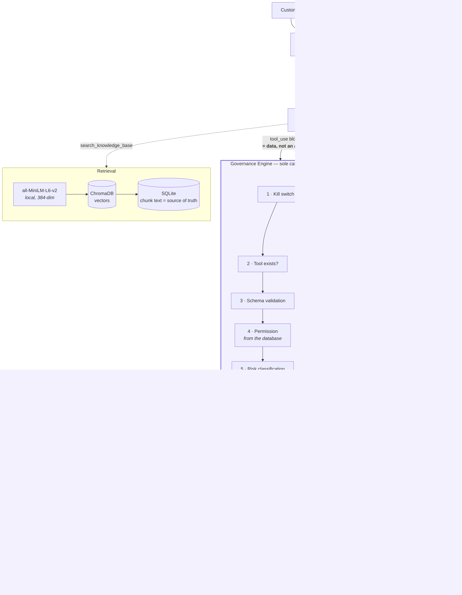
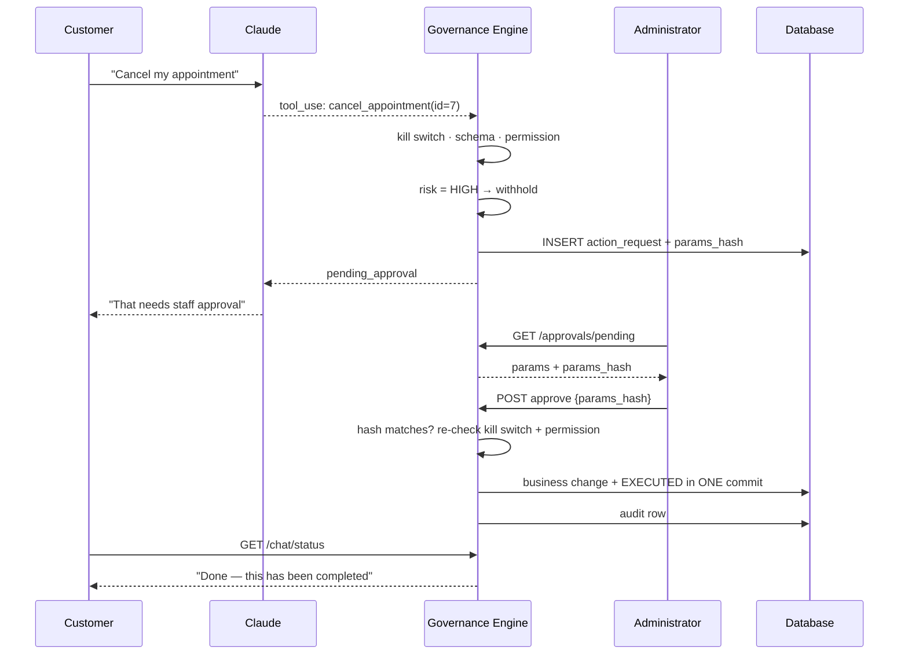

# NexaDesk AI

An AI business concierge with an enterprise agent governance layer, built
for the Napster AI Solutions Architect Intern process.

```
backend/      FastAPI, SQLAlchemy, ChromaDB, Claude    170 tests
frontend/     React, TypeScript, Vite, Tailwind v4
screenshots/  captured from the running application
```

## The idea in one sentence

> The LLM never executes anything. It only emits a request. A deterministic
> governance engine is the sole caller of every tool implementation.

Everything else follows from that. Permissions live in the database, not
the prompt. Risk is a property of the tool, not something the model reports
about itself. High-risk actions are withheld until a named human approves
the exact parameters. Every path — including every refusal — writes an
append-only audit row.

The strongest evidence is `backend/tests/test_prompt_injection.py`, where a
model scripted to **fully obey** a poisoned document still cannot cancel an
appointment.

## Architecture



**The one line that matters:** the orchestrator receives a `tool_use` block
from Claude and treats it as *data*. It has no import path to any tool
implementation — enforced by a test that parses every module under
`app/agent/` and fails the build if one imports `app.tools`. A permission
check the agent could skip by importing a function directly would be
theatre.

### Request path for a high-risk action



## Quick start (Windows PowerShell)

**If you just want it running:**

```powershell
.\setup.ps1                 # one time: venv, dependencies, .env, migrations, admin
cd backend; .\.venv\Scripts\Activate.ps1; python -m scripts.seed_demo; cd ..
.\start.ps1                 # starts both servers and opens the browser
```

Then see [`DEMO.md`](DEMO.md) for a 5-7 minute walkthrough script.

Everything works without an Anthropic API key **except the chat replying**.
To enable it, put your key in `backend\.env` as `ANTHROPIC_API_KEY=sk-ant-...`
and restart. Anthropic gives $5 of free credits for a verified phone number,
which is far more than this project needs.

<details>
<summary>Manual setup, step by step</summary>


```powershell
# --- backend ---
Set-ExecutionPolicy -Scope Process -ExecutionPolicy RemoteSigned
cd backend
py -3.12 -m venv .venv
.\.venv\Scripts\Activate.ps1
pip install -r requirements.txt

Copy-Item .env.example .env
notepad .env          # ANTHROPIC_API_KEY and a JWT_SECRET
python -c "import secrets; print(secrets.token_urlsafe(48))"   # JWT_SECRET

alembic upgrade head
python -m scripts.create_admin
python -m scripts.verify_embeddings     # confirms the real model works
uvicorn app.main:app --reload

# --- frontend (second terminal) ---
cd frontend
npm install
npm run dev           # http://localhost:5173
```

</details>

Customer chat at `/`, staff console at `/admin`.

## Documentation

| Document | Covers |
|---|---|
| [`backend/README.md`](backend/README.md) | Architecture, the governance invariant, test matrix, limitations |
| [`backend/docs/API.md`](backend/docs/API.md) | Every endpoint, request and response |
| [`backend/docs/RECOVERY.md`](backend/docs/RECOVERY.md) | Execution guarantees and crash recovery |
| [`backend/docs/RAG.md`](backend/docs/RAG.md) | Ingestion, retrieval, untrusted document content |
| [`frontend/README.md`](frontend/README.md) | Routes, auth handling, accessibility, bundle |
| [`DEMO.md`](DEMO.md) | Recording script, timings, and interview questions |
